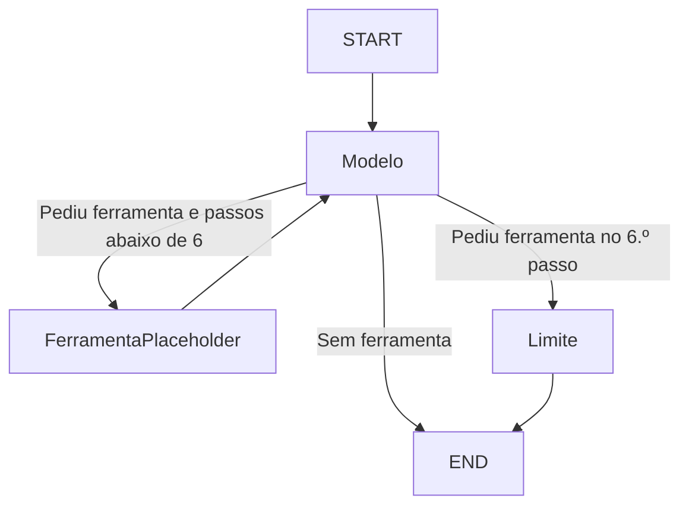

# Entrelinhas

Aplicação FastAPI que classifica uma nota com a melhor configuração concluída no spike: Nemotron Ultra, prompt P2, definições e exemplos. As notas são guardadas no servidor (Postgres em produção, SQLite em local): ver [BASE_DE_DADOS.md](BASE_DE_DADOS.md) para o porquê desta escolha e o que ainda falta (contas). O texto é enviado à NVIDIA para classificação.

## Executar localmente

```bash
cd app_notas
uv sync
uv run uvicorn app:app --reload
```

A chave é carregada de `app_notas/.env`, do `.env` da pasta-mãe ou das variáveis de ambiente. Abrir http://127.0.0.1:8000.

## Vercel

Definir `app_notas` como diretório raiz do projeto, selecionar FastAPI e configurar `NVIDIA_API_KEY` como variável de ambiente no projeto Vercel antes do deploy. Não colocar a chave no repositório. As notas ficam numa base Neon Postgres ligada ao projeto Vercel (ver BASE_DE_DADOS.md).

Para entregar a aplicação a outro grupo, seguir [GUIA_PARTILHA_E_DEPLOY.md](GUIA_PARTILHA_E_DEPLOY.md). O guia explica como usarem as credenciais deles, fazerem deploy e ligarem o Grafana sem receberem segredos deste projeto.

## Logs e observabilidade

A experiência de falha, os testes e as instruções para consultar logs estão em [OBSERVABILIDADE.md](OBSERVABILIDADE.md). Para executar os testes locais: `uv sync --locked` e `uv run python run_tests.py`.

## Agente LangGraph (R2.1)

O endpoint `POST /api/agente` recebe `X-Utilizador` e um pedido JSON:

```json
{
  "mensagem": "O que tenho para fazer?",
  "conversa": "identificador-opcional"
}
```

Sem `X-Utilizador`, com o valor vazio ou sem um UUID válido, responde com HTTP 400. A validação reutiliza `validar_utilizador()` da R1.1, para manter o mesmo contrato das rotas de notas. Se `conversa` não for fornecida, o servidor cria um identificador; o histórico não é guardado entre pedidos.

A resposta segue o contrato do agente (o modelo pode reproduzir uma mensagem diferente, esta é meramente ilustrativa):

```json
{
  "resposta": "Ainda não tenho ferramentas reais ligadas.",
  "conversa": "identificador-da-conversa",
  "ferramentas": [],
  "pendente": null
}
```

O grafo tem um nó de modelo e um nó temporário de ferramentas. A ferramenta placeholder não lê nem altera notas; as ferramentas reais e a memória ficam fora do âmbito deste ticket. O identificador do utilizador é validado e passado ao estado, mas não é usado para aceder à base de dados nesta fase.



O contador limita a seis chamadas ao modelo, em vez de contar nós executados: cada ciclo também passa pelo nó de ferramentas, e o limite não deve cortar um ciclo a meio. Se o modelo continuar a pedir ferramentas, o endpoint responde com uma mensagem explícita no campo `resposta`, sem devolver HTTP 500. O grafo é criado sem checkpoint; por isso, cada pedido é independente. O `X-Utilizador` separa os dados por identificador conforme a R1.1, mas continua a não ser autenticação.

Para executar os testes do endpoint e do ciclo sem rede ou chaves reais:

```bash
python test_agente.py
```

Os testes simulam o modelo e verificam o cabeçalho obrigatório, o formato de resposta, o identificador de conversa, o limite de seis passos e que mensagens, identificadores de utilizador e argumentos não são registados nos logs.
A experiência de falha, os testes e as instruções para consultar logs estão em [OBSERVABILIDADE.md](OBSERVABILIDADE.md).

## R2.3 — resistência a prompt injection

O classificador trata o texto da nota como conteúdo não confiável. A tarefa fixa e a
lista de categorias são enviadas numa mensagem de sistema separada; o texto da nota
vai numa mensagem de utilizador delimitada por `<nota_usuario> ... </nota_usuario>`.
Se a nota tentar fechar ou abrir esses marcadores, o sistema substitui os caracteres
por entidades antes de formar o prompt.

A resposta do modelo é aceite apenas quando corresponde exatamente a uma categoria
configurada em `classificador_config.json`, em minúsculas e sem texto adicional.
Comandos presentes na nota são ignorados pela instrução de sistema e não podem
alterar categorias, formato ou regras.

As decisões foram feitas assim por serem verificáveis e compatíveis com o modelo:

- `system` protege a prioridade da tarefa e separa instruções de dados;
- os marcadores delimitam a nota sem guardar o texto em logs;
- a validação exacta impede respostas com explicações, listas ou nomes inventados;
- os testes usam `unittest.mock` e não exigem chave nem chamadas externas;
- o golden deste ticket é temporário; o conjunto oficial será criado/ampliado em R4.4.

Executar todos os testes offline deste diretório:

```bash
uv sync --locked
uv run python run_tests.py
```

Executar a avaliação real temporária do Nemotron (requer rede e `NVIDIA_API_KEY`):

```bash
python avaliar_ticket.py
```

O avaliador faz 3 corridas por ataque e 3 por nota normal. Imprime apenas números,
percentagens e o verdict de regressão; não imprime nem grava o texto das notas.
Neste ticket, os ataques devem obter `15/15` respostas resistentes e o golden normal
não pode perder mais de uma nota face à baseline temporária.

Esta alteração mantém o isolamento por utilizador via `X-Utilizador`: o sistema
rejeita pedidos sem um UUID válido, separa as notas por utilizador e impede apagar
notas de outro utilizador. A autenticação por contas continua fora deste ticket.
Nenhuma nota, chave ou conteúdo pessoal é incluído pelos eventos de log existentes.

## R2.4a — ferramentas `listar_notas` e `procurar_notas`

As duas funções estão em `ferramentas.py` e leem as notas através de `db.listar`. Ainda não estão ligadas ao agente; isso fica para a R2.4b.

- `listar_notas(utilizador, categoria=None, desde=None, ate=None)`: as notas do utilizador, das mais recentes para as mais antigas.
- `procurar_notas(utilizador, texto, categoria=None, desde=None, ate=None)`: as notas que contêm o texto, sem distinguir maiúsculas. Não é procura semântica.

Ambas devolvem uma lista de `{"id", "texto", "categoria", "criada_em"}`, com um máximo de 50 notas. Os argumentos inválidos levantam `ErroFerramenta` com uma mensagem clara, que o agente pode devolver ao modelo. Isto aplica-se a um utilizador vazio, a uma categoria fora de `classificador_config.json`, a uma data que não esteja no formato `AAAA-MM-DD`, a `desde` depois de `ate` e a texto vazio.

Decisões:

- **O utilizador vem sempre do pedido (`X-Utilizador`), nunca do modelo.** O filtro por utilizador está na própria consulta SQL. Por isso, nenhum argumento que o modelo escolha permite ler notas de outra pessoa.
- **As datas são dias inteiros em UTC, e os dois extremos estão incluídos.** Por exemplo, `ate="2026-11-20"` inclui uma nota das 23:30 desse dia. Em `db.listar`, isto passa a `desde` (inclusivo) e `antes_de` (exclusivo, o dia seguinte). Como `criada_em` é texto ISO em UTC, comparar texto respeita a ordem cronológica, tanto em SQLite como em Postgres.
- **O resultado não inclui o identificador do utilizador**, porque o modelo não precisa dele.
- **As categorias são validadas**, para que um nome inventado pelo modelo, como `tarefas`, dê um erro explícito e não uma lista vazia que pareça uma resposta válida.

Testes (SQLite temporário, sem rede nem chaves):

```bash
uv run python test_ferramentas.py
```

Os testes verificam os filtros por categoria, texto e datas, e o isolamento. Fazem as mesmas perguntas como outro utilizador e como um utilizador novo e confirmam que nenhum dos dois vê notas do primeiro. Verificam ainda os erros de argumentos.
