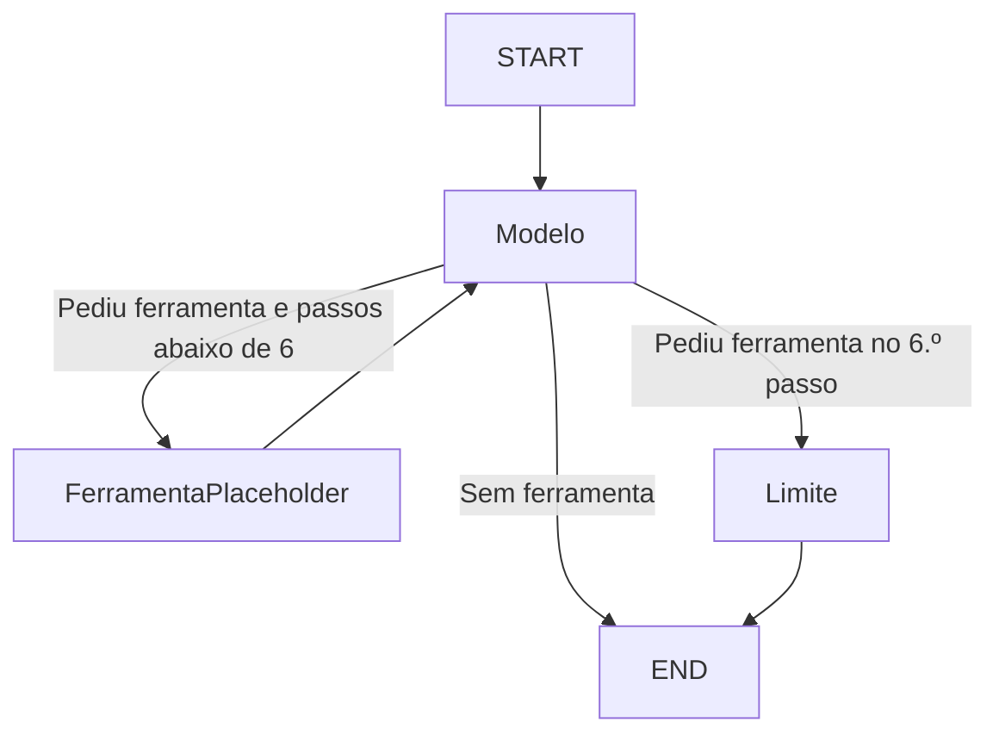

# Entrelinhas

## R4.4 — avaliação do classificador

O ficheiro `golden.json` contém as 34 notas e etiquetas fornecidas pela equipa no CSV do golden criado no Excalidraw. Os textos foram mantidos como no CSV; as etiquetas foram normalizadas em UTF-8, sem alterar as categorias. Para avaliar o mesmo classificador usado pela aplicação, configura `NVIDIA_API_KEY` no ambiente local e executa `uv run python avaliar.py --corridas 3` em `app_notas/`. São 102 chamadas reais, sujeitas a disponibilidade e eventuais custos do fornecedor.

O comando mostra o acerto médio e o desvio padrão populacional por corrida, tokens médios de entrada e saída, latência p50/p95 pelo método nearest-rank e a lista de erros nas notas do golden. As latências incluem falhas e o custo do caminho de classificação; falhas ou ausência de tokens tornam a medição incompleta e impedem o seu uso como baseline.

Baseline do golden da equipa: ainda não disponível. A tentativa de executar as 3 corridas reais foi interrompida por respostas HTTP 429 (limite de pedidos) do fornecedor; por isso, não há métricas completas para registar. As métricas anteriores pertenciam a um golden adaptado e foram removidas porque não representam as notas da equipa. Repetir a avaliação quando o fornecedor aceitar os pedidos.

A avaliação real usa uma chave autorizada para testes locais, não a credencial do projeto Vercel. As etiquetas e distribuição de categorias foram verificadas contra o CSV fornecido pela equipa. Testes offline: `uv run python test_r44.py`.

## R4.2 — acordo entre cinco classificações

`avaliar_acordo.py` classifica cada uma das 34 notas de `golden.json` cinco vezes com o mesmo modelo, prompt e schema da aplicação. Para permitir variação entre votos, usa `temperature=0.8`, como no Lab 7; a classificação normal da aplicação continua em `temperature=0`. A categoria votada é a moda única dos cinco votos. O acordo é a frequência dessa categoria dividida por cinco; um empate na moda fica sem categoria votada e conta como não resolvido. A correção compara a categoria votada com a etiqueta do golden.

Executar em `app_notas/` com `NVIDIA_API_KEY` configurada:

```bash
uv run python avaliar_acordo.py
uv run python avaliar_acordo.py --apenas-relatorio
uv run python test_r42.py
```

A avaliação completa faz 170 pedidos reais à NVIDIA, com o custo e os limites de pedidos associados à conta usada. O primeiro comando grava cada voto válido em `.r42-votos.json`, ignorado pelo Git; se surgir HTTP 429, volta a executar o mesmo comando para retomar. O segundo comando gera o relatório sem chamar a API quando os 170 votos estão completos. O resultado versionado em `../eval/r42_resultados.json` inclui as categorias dos votos e parâmetros da experiência, sem textos das notas nem chaves. Os testes são offline.

Resultado de 25 de novembro de 2026 no golden oficial (SHA-256 do JSON canónico `aca0a2ed81f871c893f18b457376ff930954335b623ab160489d0dc76771a9c1`): 26/34 categorias votadas corretas (76,5%). A tabela usa o número da nota na ordem de `golden.json`; não reproduz os textos.

| Nota | Esperado | Votos | Votada | Acordo | Acertou? |
| ---: | --- | --- | --- | ---: | --- |
| 1 | preocupações | preocupações×5 | preocupações | 5/5 (100%) | sim |
| 2 | social | social×5 | social | 5/5 (100%) | sim |
| 3 | trabalho | tarefa×5 | tarefa | 5/5 (100%) | não |
| 4 | tarefa | tarefa×5 | tarefa | 5/5 (100%) | sim |
| 5 | preocupações | preocupações×5 | preocupações | 5/5 (100%) | sim |
| 6 | foco | foco×4, tarefa×1 | foco | 4/5 (80%) | sim |
| 7 | tarefa | tarefa×5 | tarefa | 5/5 (100%) | sim |
| 8 | aprendizagem | agenda×5 | agenda | 5/5 (100%) | não |
| 9 | ideia | ideia×5 | ideia | 5/5 (100%) | sim |
| 10 | aprendizagem | aprendizagem×5 | aprendizagem | 5/5 (100%) | sim |
| 11 | tarefa | tarefa×5 | tarefa | 5/5 (100%) | sim |
| 12 | outros | ideia×5 | ideia | 5/5 (100%) | não |
| 13 | foco | tarefa×5 | tarefa | 5/5 (100%) | não |
| 14 | agenda | agenda×5 | agenda | 5/5 (100%) | sim |
| 15 | agenda | agenda×5 | agenda | 5/5 (100%) | sim |
| 16 | aprendizagem | aprendizagem×5 | aprendizagem | 5/5 (100%) | sim |
| 17 | pessoal | pessoal×5 | pessoal | 5/5 (100%) | sim |
| 18 | outros | outros×5 | outros | 5/5 (100%) | sim |
| 19 | agenda | agenda×5 | agenda | 5/5 (100%) | sim |
| 20 | aprendizagem | tarefa×5 | tarefa | 5/5 (100%) | não |
| 21 | social | pessoal×1, social×4 | social | 4/5 (80%) | sim |
| 22 | ideia | ideia×5 | ideia | 5/5 (100%) | sim |
| 23 | trabalho | trabalho×5 | trabalho | 5/5 (100%) | sim |
| 24 | aprendizagem | aprendizagem×5 | aprendizagem | 5/5 (100%) | sim |
| 25 | tarefa | tarefa×5 | tarefa | 5/5 (100%) | sim |
| 26 | foco | foco×5 | foco | 5/5 (100%) | sim |
| 27 | ideia | ideia×5 | ideia | 5/5 (100%) | sim |
| 28 | pessoal | tarefa×5 | tarefa | 5/5 (100%) | não |
| 29 | tarefa | agenda×2, tarefa×3 | tarefa | 3/5 (60%) | sim |
| 30 | social | social×5 | social | 5/5 (100%) | sim |
| 31 | aprendizagem | aprendizagem×5 | aprendizagem | 5/5 (100%) | sim |
| 32 | preocupações | outros×4, preocupações×1 | outros | 4/5 (80%) | não |
| 33 | ideia | ideia×5 | ideia | 5/5 (100%) | sim |
| 34 | trabalho | tarefa×5 | tarefa | 5/5 (100%) | não |

| Acordo | Certas | Erradas | Empates |
| ---: | ---: | ---: | ---: |
| 3/5 (60%) | 1 | 0 | 0 |
| 4/5 (80%) | 2 | 1 | 0 |
| 5/5 (100%) | 23 | 7 | 0 |

**Decisão:** o acordo não separa as notas certas das erradas neste golden. Houve 30 notas com acordo de 5/5: 23 certas e 7 erradas. Nas quatro com acordo inferior a 5/5, três estavam certas e uma errada. Enviar para revisão apenas as notas com acordo inferior a 5/5 detetaria 1 dos 8 erros e deixaria passar 7. Por isso, não há um limiar de acordo justificável para dispensar revisão; este resultado não autoriza usar o acordo como confiança na aplicação. A repetição do mesmo prompt/modelo pode reproduzir sistematicamente um erro, e o golden de 34 notas é pequeno para validar um limiar operacional. Mantemos a classificação de produção inalterada e não ativamos encaminhamento automático por acordo.

Aplicação FastAPI que classifica uma nota com a melhor configuração concluída no spike: Nemotron Ultra, prompt P2, definições e exemplos. As notas são guardadas no servidor (Postgres em produção, SQLite em local): ver [BASE_DE_DADOS.md](BASE_DE_DADOS.md) para o porquê desta escolha e o que ainda falta (contas). O texto é enviado à NVIDIA para classificação.

## Executar localmente

```bash
cd app_notas
uv sync
uv run uvicorn app:app --reload
```

A chave é carregada de `app_notas/.env`, do `.env` da pasta-mãe ou das variáveis de ambiente. Abrir http://127.0.0.1:8000.

## Vercel

Definir `app_notas` como diretório raiz do projeto, selecionar FastAPI e configurar `NVIDIA_API_KEY` como variável de ambiente no projeto Vercel antes do deploy. Não colocar a chave no repositório. As notas ficam numa base Neon Postgres ligada ao projeto Vercel (ver BASE_DE_DADOS.md).

### Deploy automático de produção

O workflow de GitHub Actions executa as verificações e os testes do CI em cada push. Só quando todos passam num push à `main`, o workflow publica em produção através da Vercel CLI. O endpoint `/api/versao` devolve os primeiros 7 caracteres do SHA publicado.

Configurar os secrets `VERCEL_TOKEN`, `VERCEL_ORG_ID` e `VERCEL_PROJECT_ID` nas definições do repositório GitHub. Não guardar esses valores no código. Para evitar deploys duplicados ou previews fora deste workflow, desligar a integração Git do projeto em **Vercel → Project Settings → Git**; a publicação passa a ser feita apenas pela CLI do workflow.

Para entregar a aplicação a outro grupo, seguir [GUIA_PARTILHA_E_DEPLOY.md](GUIA_PARTILHA_E_DEPLOY.md). O guia explica como usarem as credenciais deles, fazerem deploy e ligarem o Grafana sem receberem segredos deste projeto.

## Logs e observabilidade

A experiência de falha, os testes e as instruções para consultar logs estão em [OBSERVABILIDADE.md](OBSERVABILIDADE.md). Para executar os testes locais: `uv sync --locked` e `uv run python run_tests.py`.

## Agente LangGraph (R2.1)

O endpoint `POST /api/agente` recebe `X-Utilizador` e um pedido JSON:

```json
{
  "mensagem": "O que tenho para fazer?",
  "conversa": "identificador-opcional"
}
```

Sem `X-Utilizador`, com o valor vazio ou sem um UUID válido, responde com HTTP 400. A validação reutiliza `validar_utilizador()` da R1.1, para manter o mesmo contrato das rotas de notas. Se `conversa` não for fornecida, o servidor cria um identificador; o cliente deve reutilizar o valor devolvido para continuar essa conversa.

A resposta segue o contrato do agente (o modelo pode reproduzir uma mensagem diferente, esta é meramente ilustrativa):

```json
{
  "resposta": "Ainda não tenho ferramentas reais ligadas.",
  "conversa": "identificador-da-conversa",
  "ferramentas": [],
  "pendente": null
}
```

O grafo tem um nó de modelo e um nó temporário de ferramentas. A ferramenta placeholder não lê nem altera notas; as ferramentas reais continuam fora do âmbito deste ticket.



O contador limita a seis chamadas ao modelo, em vez de contar nós executados: cada ciclo também passa pelo nó de ferramentas, e o limite não deve cortar um ciclo a meio. Se o modelo continuar a pedir ferramentas, o endpoint responde com uma mensagem explícita no campo `resposta`, sem devolver HTTP 500.

O checkpointer do LangGraph guarda o estado da conversa na base de dados: Neon Postgres em produção e SQLite em local/testes. O estado é isolado pelo par utilizador/conversa e continua disponível depois de um novo deploy. O `X-Utilizador` separa os dados por identificador conforme a R1.1, mas continua a não ser autenticação.

Em cada chamada ao modelo, o prompt inclui a mensagem de sistema e no máximo as 20 mensagens mais recentes da conversa. Reenviar histórico aumenta os tokens e o custo por turno, como explorado no Lab 8; este limite mantém esse custo controlado. Não é criado um resumo: mensagens antigas podem deixar de estar no contexto enviado ao modelo, embora permaneçam no checkpoint.

Para executar os testes do endpoint e do ciclo sem rede ou chaves reais:

```bash
python test_agente.py
```

Os testes simulam o modelo e verificam o cabeçalho obrigatório, o formato de resposta, o identificador de conversa, o limite de seis passos e que mensagens, identificadores de utilizador e argumentos não são registados nos logs.
A experiência de falha, os testes e as instruções para consultar logs estão em [OBSERVABILIDADE.md](OBSERVABILIDADE.md).

## R2.3 — resistência a prompt injection

O classificador trata o texto da nota como conteúdo não confiável. A tarefa fixa e a
lista de categorias são enviadas numa mensagem de sistema separada; o texto da nota
vai numa mensagem de utilizador delimitada por `<nota_usuario> ... </nota_usuario>`.
Se a nota tentar fechar ou abrir esses marcadores, o sistema substitui os caracteres
por entidades antes de formar o prompt.

A resposta do modelo é aceite apenas quando corresponde exatamente a uma categoria
configurada em `classificador_config.json`, em minúsculas e sem texto adicional.
Comandos presentes na nota são ignorados pela instrução de sistema e não podem
alterar categorias, formato ou regras.

As decisões foram feitas assim por serem verificáveis e compatíveis com o modelo:

- `system` protege a prioridade da tarefa e separa instruções de dados;
- os marcadores delimitam a nota sem guardar o texto em logs;
- a validação exacta impede respostas com explicações, listas ou nomes inventados;
- os testes usam `unittest.mock` e não exigem chave nem chamadas externas;
- o golden deste ticket é temporário; o conjunto oficial será criado/ampliado em R4.4.

Executar todos os testes offline deste diretório:

```bash
uv sync --locked
uv run python run_tests.py
```

Executar a avaliação real temporária do Nemotron (requer rede e `NVIDIA_API_KEY`):

```bash
python avaliar_ticket.py
```

O avaliador faz 3 corridas por ataque e 3 por nota normal. Imprime apenas números,
percentagens e o verdict de regressão; não imprime nem grava o texto das notas.
Neste ticket, os ataques devem obter `15/15` respostas resistentes e o golden normal
não pode perder mais de uma nota face à baseline temporária.

Esta alteração mantém o isolamento por utilizador via `X-Utilizador`: o sistema
rejeita pedidos sem um UUID válido, separa as notas por utilizador e impede apagar
notas de outro utilizador. A autenticação por contas continua fora deste ticket.
Nenhuma nota, chave ou conteúdo pessoal é incluído pelos eventos de log existentes.

## Datas das notas de agenda (R2.2)

Ao criar uma nota classificada como `agenda`, a resposta e a listagem incluem o campo `quando`. É uma data ISO 8601 (`2026-12-10`), uma data com hora local (`2026-12-10T15:30:00`), ou `null` quando não é possível identificar uma data. Outras categorias ficam com `null`. Não são criados lembretes.

A aplicação faz uma chamada adicional ao mesmo modelo apenas para notas classificadas como `agenda`. O modelo identifica o evento principal e copia literalmente a expressão de data, hora e evidência; o código valida os excertos contra a nota e converte a expressão para ISO localmente. O modelo não fornece a data ISO. O resolvedor reconhece datas `AAAA-MM-DD`, `DD/MM/AAAA`, `DD/MM`, `10 de dezembro` (com ano opcional), `hoje`, `amanhã` e dias da semana, incluindo a gralha `sabádp`. Reconhece horas como `21:30`, `21h30`, `21h` e algumas horas por extenso. Sem hora precisa guarda só a data. A data de referência é a data atual em `Europe/Lisbon`; um dia da semana significa a próxima ocorrência, incluindo hoje, e sem ano uma data anterior à referência é interpretada no ano seguinte. A hora guardada é local e não contém fuso nem desambiguação de mudança de hora.

Se a nota estiver incerta, cancelada, sem dia definido, tiver compromissos igualmente centrais, ou se a resposta do modelo não passar as validações, `quando` fica `null`. Uma falha temporária do modelo também não impede guardar a nota: fica `null` e é registado apenas um evento de diagnóstico sem o texto da nota. A chamada adicional aumenta a latência e o custo das notas de agenda; o texto já é enviado ao mesmo fornecedor para classificação. A avaliação atual usa notas sintéticas criadas internamente e não demonstra desempenho em notas reais nem substitui revisão externa. Notas antigas e importadas ficam com `quando` vazio, sem extração retroativa. O esquema é atualizado automaticamente, preservando as notas existentes; testar a migração em Postgres antes do deploy.

Para verificar a integração offline da R2.2:

```bash
uv run python test_agenda.py
uv run python avaliar_agenda.py
uv run python run_tests.py
```

`test_agenda.py` simula as respostas do modelo e verifica a extração, a validação literal, os casos ambíguos, erros e persistência sem chamar a API. `avaliar_agenda.py` testa o extrator real contra as 10 notas sintéticas em `eval/agenda.jsonl`, imprime os resultados e requer `NVIDIA_API_KEY` e acesso à API. O critério é pelo menos 8/10 e zero erros técnicos. O holdout interno de 40 notas também foi sintético; os seus resultados são indicativos e não substituem avaliação independente com dados representativos.

## R4.1 — resposta JSON validada

O pedido de classificação usa `response_format` com um JSON Schema estrito: a resposta só pode ser um objeto com a chave `categoria`, cujo valor tem de pertencer às categorias configuradas. A aplicação volta a validar o conteúdo recebido, porque uma resposta do fornecedor pode falhar o contrato. Nesse caso devolve HTTP 502, regista `categoria_invalida` sem guardar o texto da nota e não cria nem altera dados.

Para verificar este comportamento sem chave nem rede:

```bash
uv run python test_r41.py
```

Para confirmar que a alteração não baixou o resultado do golden de R4.4, executar a avaliação real com a chave NVIDIA configurada:

```bash
uv run python avaliar.py --corridas 3
```

## R2.4a — ferramentas `listar_notas` e `procurar_notas`

As duas funções estão em `ferramentas.py` e leem as notas através de `db.listar`. A ligação ao agente está descrita na secção R2.4b.

- `listar_notas(utilizador, categoria=None, desde=None, ate=None)`: as notas do utilizador, das mais recentes para as mais antigas.
- `procurar_notas(utilizador, texto, categoria=None, desde=None, ate=None)`: as notas que contêm o texto, sem distinguir maiúsculas. Não é procura semântica.

Ambas devolvem uma lista de `{"id", "texto", "categoria", "criada_em"}`, com um máximo de 50 notas. Os argumentos inválidos levantam `ErroFerramenta` com uma mensagem clara, que o agente pode devolver ao modelo. Isto aplica-se a um utilizador vazio, a uma categoria fora de `classificador_config.json`, a uma data que não esteja no formato `AAAA-MM-DD`, a `desde` depois de `ate` e a texto vazio.

Decisões:

- **O utilizador vem sempre do pedido (`X-Utilizador`), nunca do modelo.** O filtro por utilizador está na própria consulta SQL. Por isso, nenhum argumento que o modelo escolha permite ler notas de outra pessoa.
- **As datas são dias inteiros em UTC, e os dois extremos estão incluídos.** Por exemplo, `ate="2026-11-20"` inclui uma nota das 23:30 desse dia. Em `db.listar`, isto passa a `desde` (inclusivo) e `antes_de` (exclusivo, o dia seguinte). Como `criada_em` é texto ISO em UTC, comparar texto respeita a ordem cronológica, tanto em SQLite como em Postgres.
- **O resultado não inclui o identificador do utilizador**, porque o modelo não precisa dele.
- **As categorias são validadas**, para que um nome inventado pelo modelo, como `tarefas`, dê um erro explícito e não uma lista vazia que pareça uma resposta válida.

Testes (SQLite temporário, sem rede nem chaves):

```bash
uv run python test_ferramentas.py
```

Os testes verificam os filtros por categoria, texto e datas, e o isolamento. Fazem as mesmas perguntas como outro utilizador e como um utilizador novo e confirmam que nenhum dos dois vê notas do primeiro. Verificam ainda os erros de argumentos.

## R2.4b — o agente usa `listar_notas` e `procurar_notas`

O `POST /api/agente` passou a oferecer ao modelo as duas ferramentas da R2.4a, em vez da ferramenta temporária da R2.1. Quando o modelo pede uma delas, o nó de ferramentas do grafo executa-a e devolve-lhe o resultado. Por exemplo:

- "O que tenho para fazer?" → `listar_notas` com `categoria: "tarefa"`;
- "Tenho alguma coisa com a Sofia?" → `procurar_notas` com `texto: "Sofia"`.

O campo `ferramentas` da resposta mostra que ferramentas foram chamadas e com que argumentos.

Decisões:

- **O utilizador vem do pedido (`X-Utilizador`), nunca dos argumentos do modelo.** O `app.py` passa ao agente uma função de ferramentas já ligada ao utilizador do pedido, e por isso o utilizador não fica guardado na memória da conversa (R1.4). `ferramentas.executar` recusa argumentos fora do esquema, como `utilizador`. Assim, nem um prompt injection numa nota consegue pedir notas de outra pessoa.
- **Os erros voltam ao modelo como texto** (categoria desconhecida, data inválida, ferramenta inexistente), para ele poder corrigir o pedido. O pedido HTTP não falha por isso.
- **O `agente.py` não conhece a base de dados:** recebe a função `executar_ferramenta(nome, args)` por parâmetro. Sem ela, mantém o comportamento da R2.1 ("ferramenta indisponível").
- **O modelo recebe a data de hoje (UTC)**, para conseguir preencher `desde`/`ate` em pedidos como "esta semana". A data é juntada à mensagem de sistema em cada chamada ao modelo e não fica na memória da conversa, onde estaria desatualizada no dia seguinte. A mensagem de sistema pede também que o modelo responda só com o que as ferramentas devolverem.
- **As ferramentas são só de leitura.** Criar, alterar ou apagar notas fica para tickets próprios (R2.5 e R3).

Testes sem rede nem chaves (modelo simulado, SQLite temporário com as 34 notas do `golden.json`):

```bash
uv run python test_r24b.py
```

Verificam as duas perguntas de aceitação (as 5 tarefas e nenhuma nota de outra categoria; a nota da Sofia), o campo `ferramentas`, o isolamento (outro utilizador não vê nenhuma nota do primeiro, mesmo que o modelo tente passar `utilizador`), os erros de argumentos e que os logs não têm texto de notas nem identificadores.

Avaliação com o modelo real (requer rede e `NVIDIA_API_KEY`; usa um SQLite temporário e imprime só resultados, nunca o texto das notas):

```bash
uv run python avaliar_r24b.py --corridas 3
```

Resultado em 2026-11-25: todos os critérios passaram em 3/3 corridas.

Os testes novos retiram `DATABASE_URL` **depois** de `import app`, porque o `app.py` volta a carregar o `.env`, e param se ainda houver ligação a Postgres. Se as retirassem antes do import, um `.env` local com a base de dados de produção faria os testes escrever lá.
