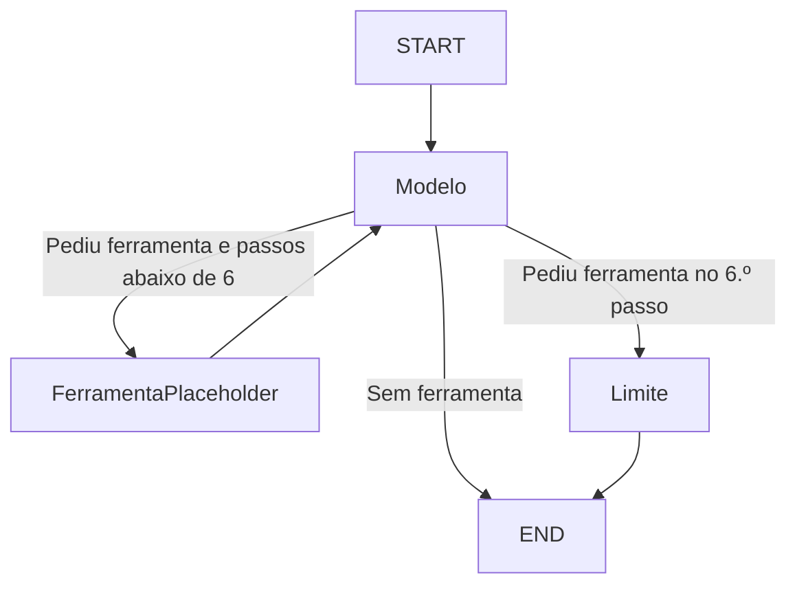

# Entrelinhas

Aplicação FastAPI que classifica uma nota com a melhor configuração concluída no spike: Nemotron Ultra, prompt P2, definições e exemplos. As notas são guardadas no servidor (Postgres em produção, SQLite em local): ver [BASE_DE_DADOS.md](BASE_DE_DADOS.md) para o porquê desta escolha e o que ainda falta (contas). O texto é enviado à NVIDIA para classificação.

## Executar localmente

```bash
cd app_notas
uv sync
uv run uvicorn app:app --reload
```

A chave é carregada de `app_notas/.env`, do `.env` da pasta-mãe ou das variáveis de ambiente. Abrir http://127.0.0.1:8000.

## Vercel

Definir `app_notas` como diretório raiz do projeto, selecionar FastAPI e configurar `NVIDIA_API_KEY` como variável de ambiente no projeto Vercel antes do deploy. Não colocar a chave no repositório. As notas ficam numa base Neon Postgres ligada ao projeto Vercel (ver BASE_DE_DADOS.md).

Para entregar a aplicação a outro grupo, seguir [GUIA_PARTILHA_E_DEPLOY.md](GUIA_PARTILHA_E_DEPLOY.md). O guia explica como usarem as credenciais deles, fazerem deploy e ligarem o Grafana sem receberem segredos deste projeto.

## Logs e observabilidade

A experiência de falha, os testes e as instruções para consultar logs estão em [OBSERVABILIDADE.md](OBSERVABILIDADE.md). Para executar os testes locais: `uv sync --locked` e `uv run python run_tests.py`.

## Agente LangGraph (R2.1)

O endpoint `POST /api/agente` recebe `X-Utilizador` e um pedido JSON:

```json
{
  "mensagem": "O que tenho para fazer?",
  "conversa": "identificador-opcional"
}
```

Sem `X-Utilizador`, com o valor vazio ou sem um UUID válido, responde com HTTP 400. A validação reutiliza `validar_utilizador()` da R1.1, para manter o mesmo contrato das rotas de notas. Se `conversa` não for fornecida, o servidor cria um identificador; o histórico não é guardado entre pedidos.

A resposta segue o contrato do agente (o modelo pode reproduzir uma mensagem diferente, esta é meramente ilustrativa):

```json
{
  "resposta": "Ainda não tenho ferramentas reais ligadas.",
  "conversa": "identificador-da-conversa",
  "ferramentas": [],
  "pendente": null
}
```

O grafo tem um nó de modelo e um nó temporário de ferramentas. A ferramenta placeholder não lê nem altera notas; as ferramentas reais e a memória ficam fora do âmbito deste ticket. O identificador do utilizador é validado e passado ao estado, mas não é usado para aceder à base de dados nesta fase.



O contador limita a seis chamadas ao modelo, em vez de contar nós executados: cada ciclo também passa pelo nó de ferramentas, e o limite não deve cortar um ciclo a meio. Se o modelo continuar a pedir ferramentas, o endpoint responde com uma mensagem explícita no campo `resposta`, sem devolver HTTP 500. O grafo é criado sem checkpoint; por isso, cada pedido é independente. O `X-Utilizador` separa os dados por identificador conforme a R1.1, mas continua a não ser autenticação.

Para executar os testes do endpoint e do ciclo sem rede ou chaves reais:

```bash
python test_agente.py
```

Os testes simulam o modelo e verificam o cabeçalho obrigatório, o formato de resposta, o identificador de conversa, o limite de seis passos e que mensagens, identificadores de utilizador e argumentos não são registados nos logs.
